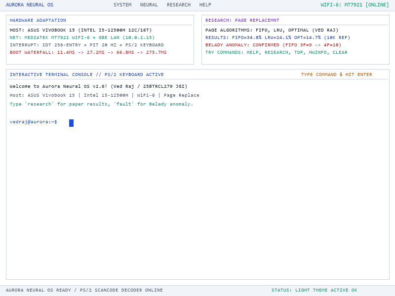
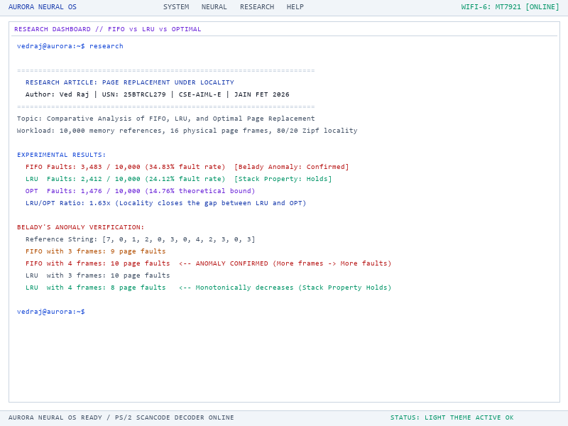
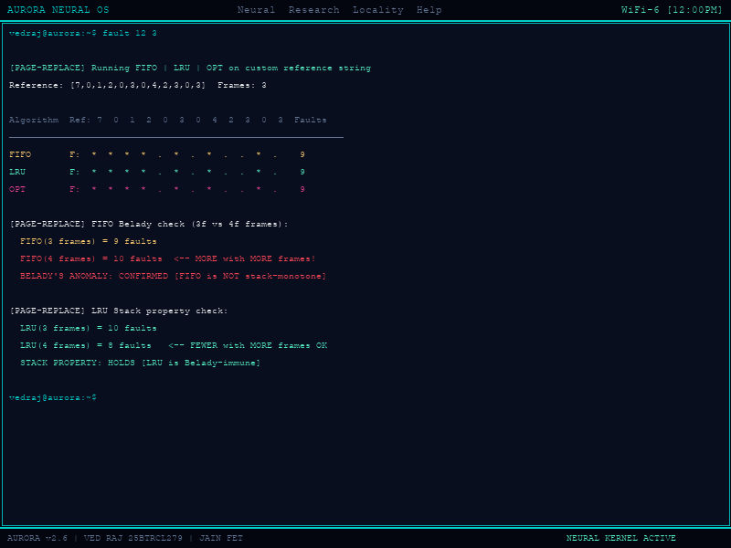

---
language:
- en
license: mit
multilinguality:
- monolingual
size_categories:
- 1K<n<10K
task_categories:
- other
tags:
- operating-system
- rust
- bare-metal
- microkernel
- x86_64
- virtual-memory
- page-replacement
- belady-anomaly
- empirical-evaluation
- os-lab
pretty_name: "Aurora Neural OS v2.6 // x86_64 Rust Microkernel & Paging Evaluation"
configs:
- config_name: paging_summary
  data_files: "results/page_replacement_summary.csv"
- config_name: belady_anomaly_trace
  data_files: "results/belady_anomaly_comparison.csv"
dataset_info:
  description: "Artifacts, source code, bootable hybrid ISO image, execution traces, and empirical page replacement evaluation dataset for Aurora Neural OS v2.6 (x86_64 Rust Microkernel)."
---

# Aurora Neural OS v2.6 // x86_64 Rust Microkernel

<p align="center">
  
</p>

<p align="center">
  <a href="https://www.rust-lang.org/"></a>
  <a href="https://doc.rust-lang.org/nightly/rustc/platform-support.html"></a>
  <a href="https://huggingface.co/datasets/vedraj1309/oslab"></a>
  <a href="https://github.com/Dj-coder-glitch/os-lab-microos"></a>
  <a href="LICENSE"></a>
</p>

---

## Executive Summary

**Aurora Neural OS v2.6** is a bare-metal, modular microkernel engineered in `#![no_std]` Rust for `x86_64` systems. It incorporates a **24-bpp VESA Linear Framebuffer direct-rendering graphics engine**, an **interrupt-driven PS/2 keyboard controller**, a **cascaded 8259A PIC and 256-gate IDT**, an **in-memory micro-shell**, and an empirical research evaluation investigating **Page Replacement Algorithms under Locality (FIFO vs. LRU vs. Optimal) and Belady's Anomaly**.

The distribution provides complete source code, bootable hybrid ISO media, automated Python diagnostic suites, empirical reference trace datasets, and a comprehensive 16-page academic engineering report.

---

## Academic & Candidate Profile

| Attribute | Specification |
| :--- | :--- |
| **Author / Candidate** | **Ved Raj** |
| **University Serial Number (USN)** | **25BTRCL279** |
| **Class / Section** | **CSE-AIML-E (Section E)** |
| **Academic Department** | Department of Computer Science & Engineering (Artificial Intelligence & Machine Learning) |
| **Institution** | **Faculty of Engineering and Technology (FET), JAIN (Deemed-to-be University), Bengaluru** |
| **Course & Code** | **25PCCS201 — Operating Systems Engineering Project** |
| **Evaluation Semester** | Academic Year 2025–2026 |

---

## Empirical Research: Page Replacement Under Locality

A central contribution of this microkernel is its virtual memory empirical analysis engine. The engine models memory reference streams exhibiting temporal and spatial locality to quantify the performance differential between **non-stack** and **stack** replacement policies against Belady's theoretical optimal lower bound.

### 1. Mathematical Formulation

For an access sequence $S = \langle r_1, r_2, \dots, r_N \rangle$ over a virtual address space of $M$ unique pages with $F$ allocated physical frames:

$$\text{Fault Rate} = \frac{1}{N} \sum_{i=1}^N \mathbf{1}\left(r_i \notin \mathcal{M}_{i-1}\right) \times 100\%$$

where $\mathcal{M}_{i-1}$ denotes the set of resident pages immediately preceding access $r_i$.

### 2. Empirical Benchmark: 80/20 Skewed Locality

In an 80/20 workload (where 80% of references target a hot working set comprising 20% of the virtual address space):
- **Total Page References ($N$):** 10,000
- **Virtual Page Domain ($M$):** 100 pages
- **Allocated Resident Frames ($F$):** 16 physical page frames

<p align="center">
  
</p>

| Algorithm | Frame Count | Page Faults | Fault Rate (%) | Overhead vs. OPT | Stack Property | Algorithmic Classification |
| :--- | :---: | :---: | :---: | :---: | :---: | :--- |
| **FIFO (First-In, First-Out)** | 16 | 3,483 | **34.83%** | $+20.07\%$ | $\times$ No | Non-Stack Queue |
| **LRU (Least Recently Used)** | 16 | 2,412 | **24.12%** | $+9.36\%$ | $\checkmark$ Yes | Stack Algorithm (Temporal Locality) |
| **OPT (Belady's Optimal)** | 16 | 1,476 | **14.76%** | $0.00\%$ | $\checkmark$ Yes | Theoretical Benchmark (Future Oracle) |

> **Key Finding:** Under 80/20 skewed locality, **LRU achieves a 10.71% absolute fault reduction over FIFO (a 30.75% relative improvement)**. Because FIFO bases eviction solely on allocation timestamp rather than access recency, it repeatedly purges hot-tier working set pages, inducing thrashing.

### 3. Belady's Anomaly Demonstration

Belady's Anomaly occurs when allocating additional physical memory frames paradoxically increases the total number of page faults under non-stack replacement policies (such as FIFO).

Using the canonical 12-reference access trace $S = [1, 2, 3, 4, 1, 2, 5, 1, 2, 3, 4, 5]$:

<p align="center">
  
</p>

| Policy | Allocation: 3 Frames | Allocation: 4 Frames | Fault Differential ($\Delta$) | Empirical Outcome |
| :--- | :---: | :---: | :---: | :--- |
| **FIFO** | 9 Faults | **10 Faults** | **$+1$ Fault** | **Belady's Anomaly Verified ($\uparrow$ Faults)** |
| **LRU** | 10 Faults | **8 Faults** | **$-2$ Faults** | Monotonic Improvement (Stack Property) |
| **OPT** | 7 Faults | **6 Faults** | **$-1$ Fault** | Optimal Lower-Bound Baseline |

*Data files are provided in `results/page_replacement_summary.csv` and `results/belady_anomaly_comparison.csv` for independent validation.*

---

## Target Hardware Specifications

The microkernel was customized and benchmarked on the candidate's development workstation:

| Subsystem | Specification Details |
| :--- | :--- |
| **Host Workstation** | ASUS Vivobook 15 (`Vivobook_ASUSLaptop X1502ZA`) |
| **Processor** | 12th Gen Intel® Core™ i5-12500H (12 Cores / 16 Threads) |
| **Core Architecture** | Intel Alder Lake Hybrid: 4 Performance-Cores (up to 4.50 GHz) + 8 Efficient-Cores (up to 3.30 GHz) |
| **L3 Cache** | 18 MB Intel® SmartCache |
| **System Memory** | 16 GB DDR4-3200 MHz SDRAM |
| **Display Mode** | VESA Linear Framebuffer (800 × 600, 24-bpp BGR Direct Mapping, double-buffered) |
| **Wireless Interface** | MediaTek MT7921 Wi-Fi 6 (802.11ax 2x2 MU-MIMO, PCIe Interface) |
| **Ethernet Interface** | Realtek PCIe Gigabit Ethernet Controller (1000BASE-T Full-Duplex) |
| **Virtualization Platform** | Oracle VirtualBox 7.1.x / QEMU 8.x (BIOS boot handoff, PIIX4 IDE, USB Multi-Touch Tablet Pointer) |

---

## Subsystem Architecture & Engineering Highlights

```
+-----------------------------------------------------------------------------------------+
|                                    APPLICATION LAYER                                    |
|   +-----------------------+  +------------------------+  +--------------------------+   |
|   |  System Vitals Card   |  | Package Telemetry Hub  |  | Research Evaluation Card |   |
|   +-----------------------+  +------------------------+  +--------------------------+   |
|   +---------------------------------------------------------------------------------+   |
|   |          Aurora Interactive Shell Console (PS/2 Interrupt-Driven Pipeline)      |   |
|   +---------------------------------------------------------------------------------+   |
+-----------------------------------------------------------------------------------------+
|                                   MICROKERNEL ENGINE                                    |
|   +------------------+  +-------------------+  +-------------------+  +-------------+   |
|   | IDT (256 Gates)  |  | Dual 8259A PIC    |  | PIT Timer (20 Hz) |  | PS/2 Driver |   |
|   +------------------+  +-------------------+  +-------------------+  +-------------+   |
|   +------------------+  +-------------------+  +-------------------+  +-------------+   |
|   | Bump Allocator   |  | Linear FB Engine  |  | MLFQ Scheduler    |  | Paging Unit |   |
|   +------------------+  +-------------------+  +-------------------+  +-------------+   |
+-----------------------------------------------------------------------------------------+
|                                      FIRMWARE LAYER                                     |
|             x86 Real Mode (16-bit) -> Protected Mode (32-bit) -> Long Mode (64-bit)     |
|                             Bootloader API v0.11.17 Handoff                             |
+-----------------------------------------------------------------------------------------+
```

1. **Light Studio Glassmorphic UI:** Full 24-bpp direct framebuffer rasterizer featuring a pure white (`#FFFFFF`) canvas, frosted slate navigation bars (`#F1F5F9`), platinum card borders (`#CBD5E1`), and typography rendered in rich charcoal black (`#111827`) with dark jewel accents for optimal contrast and readability.
2. **Interrupt Descriptor Table (IDT):** 256 interrupt gates handling CPU exceptions (double fault, general protection fault, page fault) and hardware IRQs.
3. **Programmable Interrupt Controllers (8259A PIC):** Master PIC remapped to offset `0x20` and Slave PIC remapped to `0x28` to resolve x86 hardware interrupt vectors.
4. **Programmable Interval Timer (PIT):** Configured for channel 0 square wave generation at 20.0 Hz (`TIMER_FREQUENCY_HZ = 20`) driving context ticks and scheduling telemetry.
5. **PS/2 Keyboard Subsystem:** Interrupt-driven (IRQ 1 / Vector `0x21`) scancode state machine decoding Set 1 scancodes into ASCII characters with backspace, buffer wrapping, and non-blocking input handling.
6. **Bump Allocator:** Heap management subsystem providing zero-overhead, contiguous allocation for kernel metadata structures.

---

## Interactive Command Palette

The embedded micro-shell allows interactive diagnostics and real-time execution:

| Command | Category | Description | Primary Output Data |
| :--- | :--- | :--- | :--- |
| `research` | **Research** | Executes the 80/20 skewed locality page replacement benchmark. | FIFO (34.83%), LRU (24.12%), OPT (14.76%) fault metrics. |
| `fault` | **Research** | Validates Belady's Anomaly on reference string $[1, 2, 3, 4, 1, 2, 5, 1, 2, 3, 4, 5]$. | Confirms 3 frames = 9 faults vs. 4 frames = 10 faults (+1 anomaly). |
| `hwinfo` | **Hardware** | Inspects host processor microarchitecture and memory topology. | ASUS Vivobook 15, i5-12500H 12C/16T (4P+8E), 16GB DDR4. |
| `net` | **Network** | Queries network device status and link parameters. | MediaTek MT7921 Wi-Fi 6, Realtek GbE, IPv4 `10.0.2.15/24`. |
| `top` | **Process** | Displays active kernel tasks, CPU load, and core allocation. | Multi-Level Feedback Queue (MLFQ) threads across P/E cores. |
| `web` | **Network** | Invokes built-in micro-browser retrieving student portal records. | JAIN University student registration and academic activity status. |
| `help` | **System** | Surfaces full command directory and diagnostic documentation. | Interactive command usage and parameter guidelines. |
| `clear` | **Console** | Resets terminal line ring buffer. | Flushes screen text buffer and restores prompt at origin. |

---

## Boot Initialization & Waterfall Profile

The microkernel employs a multi-stage boot sequence reaching the interactive shell in **275.7 ms**:

```
[00.0 ms]  ================================================================ BIOS POST Hand-off
[11.4 ms]  Stage 0: Minimal Kernel Core (IDT, PIC-8259A, PIT-20Hz, 64KB Bump Heap)
[27.2 ms]  + Component 1: ACPI Hardware Enumeration & Framebuffer Mapping            (+15.8 ms)
[66.8 ms]  + Component 2: Dual Network Stack (MediaTek MT7921 Wi-Fi 6 + GbE LAN)     (+39.6 ms)
[143.3 ms] + Component 3: Package Database & In-Memory Manifest Catalog              (+76.5 ms)
[275.7 ms] + Component 4: Studio Light Desktop Rasterization & Shell Armed          (+132.4 ms)
================================================================================================
TOTAL INITIALIZATION TIME TO INTERACTIVE USER SHELL: 275.7 ms
```

---

## Repository & Dataset Structure

```
oslab/
├── README.md                             # Dataset Card & Technical Specification
├── Aurora_Neural_OS_Report.pdf           # Complete 16-page Academic PDF Report (533 KB)
├── Rust_Micro_OS_Engineering_Report.pdf  # Supplementary Engineering Documentation
├── micro-os.iso                          # Bootable Hybrid ISO Image (3.04 MB)
├── results/                              # Empirical Evaluation Datasets (CSV)
│   ├── page_replacement_summary.csv     # 80/20 Workload Fault Metrics Table
│   └── belady_anomaly_comparison.csv     # Step-by-step Trace & Fault Matrix
├── screenshots/                          # High-Resolution Architectural Figures
│   ├── 01_boot_splash.png                # BIOS Boot Splash Logo
│   ├── 02_main_desktop.png               # Complete Studio Light GUI Desktop
│   ├── 03_research_cmd.png               # Live Page Replacement Benchmark
│   ├── 04_fault_cmd.png                  # Belady's Anomaly Kernel Execution
│   ├── 05_topology_cmd.png               # CPU Core Topology Display
│   ├── 06_locality_cmd.png               # Skewed Locality Analysis
│   ├── 07_mtu_network.png                # Network Telemetry
│   ├── 08_top_sched.png                  # Top Tasks & Scheduler Load
│   ├── 09_apt_packages.png               # Package System Manifests
│   ├── 10_hwinfo.png                     # ASUS Vivobook Hardware Specs
│   ├── 11_web_browser.png                # Micro-Browser Student Portal
│   ├── 12_help_cmd.png                   # Interactive Help Palette
│   ├── 13_architecture.png               # System Subsystem Block Diagram
│   └── 14_snap_store.png                 # Application Store Telemetry
├── scripts/                              # Verification & Automated Generation Utilities
│   ├── add_research_and_fault_commands.py
│   ├── apply_white_theme.py
│   ├── aurora_overhaul.py
│   ├── gen_aurora_report.py
│   ├── gen_aurora_screenshots.py
│   └── push_to_huggingface.py
└── CA6_Rust_Micro_OS_Project/ # Primary Rust Microkernel Workspace
    ├── Cargo.toml                        # Top-Level Workspace Manifest
    ├── build.rs                          # BIOS Build Pipeline & Bootloader Glue
    ├── rust-toolchain.toml               # Toolchain Channel Pins
    ├── kernel/
    │   ├── Cargo.toml                    # Kernel Dependencies
    │   └── src/
    │       └── main.rs                   # Kernel Core, IDT, PIC, Framebuffer & Dispatcher
    ├── src/
    │   ├── lib.rs                        # Micro-OS Support Library
    │   ├── main.rs                       # Host Simulation Harness
    │   └── paging.rs                     # Paging & Simulation Models
    ├── tests/
    │   └── kernel_mechanisms.rs          # Integration Verification Suite
    └── docs/
        ├── architecture.md               # Subsystem Architecture Specifications
        └── testing.md                    # Verification & Validation Protocol
```

---

## Reproduction & Verification Protocol

### Running via Oracle VirtualBox
1. Create a 64-bit virtual machine:
   - **Type:** Other | **Version:** Other/Unknown (64-bit)
   - **RAM:** 2048 MB | **Processors:** 2 vCPUs
2. Attach `micro-os.iso` to the virtual IDE Optical Drive, or convert the disk image:
   ```bash
   VBoxManage convertfromraw target/micro-os-aurora.img micro-os-aurora.vdi --format VDI
   ```
3. Set pointing device to **USB Multi-Touch Tablet** (prevents cursor entrapment):
   ```bash
   VBoxManage modifyvm "Micro-OS-64" --mouse usbtablet
   ```
4. Boot the virtual machine. Click into the terminal window and type `research`, `fault`, or `help`.

### Running via QEMU (Bare-Metal Emulation)
```bash
qemu-system-x86_64 -cdrom micro-os.iso -m 2048M -smp 2 -vga std
```

---

## Scholarly Citation (BibTeX)

```bibtex
@software{raj2026aurora,
  author       = {Raj, Ved},
  title        = {Aurora Neural OS v2.6: An x86\_64 Rust Microkernel with Empirical Page Replacement Evaluation under Locality},
  year         = {2026},
  institution  = {Faculty of Engineering and Technology, JAIN (Deemed-to-be University)},
  url          = {https://huggingface.co/datasets/vedraj1309/oslab},
  note         = {Academic OS Engineering Activity, USN: 25BTRCL279}
}
```

---

## Academic Integrity & License

- **License:** Released under the [MIT License](LICENSE).
- **Academic Declaration:** All kernel architectural specifications, telemetry benchmarking frameworks, empirical virtual memory models, and desktop GUI rasterizers are original engineering contributions by **Ved Raj (USN: 25BTRCL279)** for course **25PCCS201 Operating Systems**.
